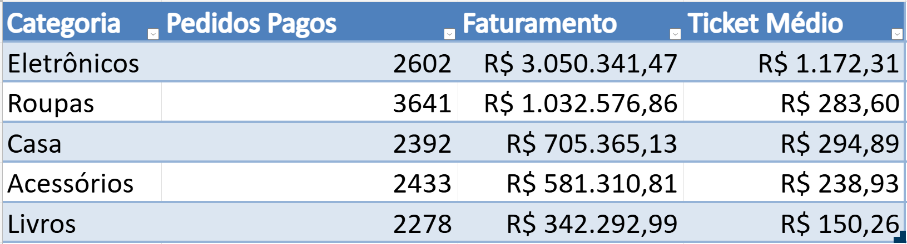
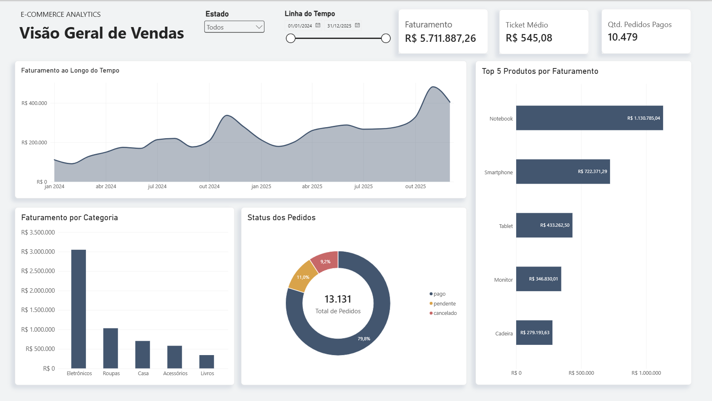

# 📊 Análise de Vendas de E-commerce | SQL, Python, Excel e Power BI

Projeto de portfólio de Análise de Dados/BI com dados sintéticos de e-commerce. O objetivo é acompanhar o desempenho comercial, analisar clientes e verificar a consistência dos dados usando PostgreSQL, SQL, Python, Pandas, Excel e Power BI.

---

## 🎯 Objetivo

Construir um fluxo de análise que permita responder a perguntas como:

- Quanto o e-commerce faturou com pedidos pagos?
- Como o faturamento evoluiu ao longo do tempo?
- Quais categorias e produtos geraram mais receita?
- Qual é a distribuição dos pedidos por status?
- Como se comportam clientes com compra única e recorrente?
- Como evolui a retenção de clientes por coorte mensal?

---

## 🛠️ Tecnologias Utilizadas

- **PostgreSQL e SQL:** modelagem relacional, auditoria e consultas analíticas.
- **Python:** geração de dados, conexão ao banco e exportação.
- **Pandas e Jupyter Notebook:** tratamento, agrupamento e análise exploratória.
- **Excel:** visualização tabular dos indicadores exportados.
- **Power BI e DAX:** dashboard interativo e indicadores comerciais.
- **Git e GitHub:** versionamento e documentação.

---

## 🗃️ Base de Dados

A base é **sintética**, produzida por `src/gerar_dados.py`, com semente definida para reprodução.

O conjunto de dados inclui:

- 3.200 clientes;
- 28 vendedores;
- 40 produtos distribuídos em cinco categorias;
- Aproximadamente 13 mil pedidos;
- Período de janeiro de 2024 a dezembro de 2025;
- Pedidos pagos, pendentes e cancelados;
- Perfis de clientes com diferentes frequências de compra;
- Sazonalidade mensal, com maior concentração de vendas em novembro.

### Estrutura do Banco de Dados

O modelo relacional possui cinco tabelas:

| Tabela | Descrição |
|---|---|
| `clientes` | Informações cadastrais e localização dos clientes |
| `vendedores` | Informações dos vendedores |
| `produtos` | Catálogo de produtos, categorias e preços |
| `pedidos` | Pedidos realizados, datas, status e relacionamentos |
| `itens_pedido` | Produtos e quantidades associados aos pedidos |

Um pedido pertence a um cliente e a um vendedor, podendo conter vários itens. Cada item está associado a um produto.

> **Premissa de negócio:** as análises financeiras consideram somente pedidos com status `pago`. Os dados são simulados e não representam operações de uma empresa real.

---

## 🔎 Análises SQL

As consultas SQL estão organizadas em seis arquivos, com diferentes objetivos analíticos.

| Arquivo | Conteúdo |
|---|---|
| `01_schema.sql` | Criação das cinco tabelas, chaves, restrições e índices |
| `02_indicadores_vendas.sql` | Faturamento, pedidos por status, clientes compradores, participação das categorias e ticket médio |
| `03_analises_relacionais_join.sql` | Top 10 clientes, desempenho de vendedores e distribuição de vendas por estado |
| `04_auditoria_dados.sql` | Verificações de integridade e identificação de registros sem relacionamentos |
| `05_analises_avancadas.sql` | Top 3 produtos por categoria, variação mensal do faturamento e faturamento acumulado |
| `06_retencao_coortes_clientes.sql` | Compras únicas e recorrentes, ticket médio por perfil e retenção mensal por coorte |

### Principais Conceitos SQL Aplicados

**Consultas e agregações:**

- `SELECT`, `WHERE` e `ORDER BY`
- `GROUP BY`
- `COUNT()` e `COUNT(DISTINCT)`
- `SUM()`, `AVG()` e `ROUND()`

**Relacionamentos:**

- `INNER JOIN`
- `LEFT JOIN`
- `CROSS JOIN`
- `NOT EXISTS`

**SQL avançado:**

- CTEs com `WITH`
- `CASE WHEN`
- `ROW_NUMBER()`
- `LAG()`
- `SUM() OVER()`
- `PARTITION BY`
- `ROWS BETWEEN`
- `DATE_TRUNC()`
- `EXTRACT()`

Essas técnicas foram utilizadas para construir indicadores, rankings, análises temporais, auditorias e estudos de comportamento dos clientes.

---

## 🐍 Python e Pandas

O Python é utilizado para gerar os dados sintéticos, conectar ao PostgreSQL e realizar análises complementares.

### Scripts Python

| Arquivo | Função |
|---|---|
| `src/gerar_dados.py` | Gera os dados sintéticos e realiza a carga no PostgreSQL |
| `src/conexao_banco.py` | Testa a conexão Python/PostgreSQL |
| `src/exportar_excel.py` | Consulta os dados, calcula indicadores e exporta para Excel |

### Jupyter Notebook

O arquivo `notebooks/analise_vendas.ipynb` utiliza Pandas para:

- Consultar os dados do PostgreSQL;
- Carregar os resultados em um DataFrame;
- Calcular o faturamento dos itens vendidos;
- Calcular faturamento total;
- Contar pedidos pagos distintos;
- Calcular ticket médio;
- Agrupar indicadores por categoria.

O notebook permite explorar os resultados e praticar a análise de dados com Python.

---

## 📗 Relatório Excel

O script `src/exportar_excel.py` gera um relatório de vendas por categoria.

O relatório apresenta:

- Categoria do produto;
- Quantidade de pedidos pagos distintos;
- Faturamento;
- Ticket médio.

O faturamento é calculado pela multiplicação da quantidade vendida pelo preço unitário.

O ticket médio de cada categoria é calculado dividindo o faturamento da categoria pela quantidade de pedidos pagos distintos associados a ela.

**Observação:** um mesmo pedido pode conter produtos de categorias diferentes. Por isso, a soma dos pedidos por categoria pode ser maior que a quantidade total de pedidos pagos.

A apresentação visual da planilha foi ajustada no Excel após a exportação.

### Visualização do Relatório



---

## 📊 Dashboard Power BI

Foi desenvolvido um dashboard interativo no Power BI Desktop, conectado ao PostgreSQL.

O relatório possui uma página denominada **Visão Geral de Vendas**.

### Indicadores Principais

- **Faturamento:** receita total dos pedidos pagos.
- **Ticket Médio:** faturamento dividido pela quantidade de pedidos pagos.
- **Pedidos Pagos:** quantidade de pedidos com status `pago`.

### Análises Visuais

O dashboard apresenta:

1. Evolução mensal do faturamento;
2. Faturamento por categoria;
3. Top 5 produtos por faturamento;
4. Distribuição dos pedidos por status.

### Filtros Interativos

- Estado do cliente;
- Período dos pedidos.

Os filtros permitem analisar os indicadores e gráficos considerando diferentes estados e intervalos de datas.

### Medidas DAX

As principais medidas utilizam:

- `CALCULATE()`
- `SUMX()`
- `DISTINCTCOUNT()`
- `DIVIDE()`

As análises financeiras consideram somente pedidos pagos. O gráfico de distribuição por status considera todos os pedidos.

### Visualização do Dashboard



### Arquivo Power BI

O arquivo original está disponível em:

[Baixar relatório Power BI (.pbix)](powerbi/relatorio_vendas_ecommerce.pbix)

O relatório pode ser aberto no Power BI Desktop.

Para atualizar os dados, é necessário configurar a conexão com o PostgreSQL no ambiente local.

---

## ⚙️ Instalação e Execução

### Pré-requisitos

- PostgreSQL;
- Python 3;
- Git;
- Visual Studio Code;
- Power BI Desktop;
- Jupyter Notebook ou ambiente compatível.

### 1. Clonar o Repositório

No terminal, execute:

```bash
git clone https://github.com/Italolima209/ecommerce-sales-sql-analysis.git
```

Entre na pasta do projeto:

```bash
cd ecommerce-sales-sql-analysis
```

### 2. Configurar o Ambiente Python

Crie um ambiente virtual:

```powershell
python -m venv .venv
```

Ative o ambiente no Windows:

```powershell
.\.venv\Scripts\Activate.ps1
```

Instale as dependências:

```powershell
python -m pip install -r requirements.txt
```

### 3. Configurar o PostgreSQL

Crie um banco de dados PostgreSQL para o projeto.

Na raiz do repositório, crie um arquivo `.env` com as configurações da conexão:

```dotenv
DB_HOST=localhost
DB_PORT=5432
DB_NAME=nome_do_banco
DB_USER=seu_usuario
DB_PASSWORD=sua_senha
```

Substitua os valores de exemplo pelas informações do seu ambiente.

**Importante:** o arquivo `.env` pode conter credenciais e não deve ser enviado ao GitHub.

### 4. Criar a Estrutura do Banco

Execute o arquivo:

`sql/01_schema.sql`

Esse script cria as tabelas, relacionamentos, restrições e índices.

**Atenção:** o script recria as tabelas e remove os dados existentes. Utilize um banco de desenvolvimento separado.

### 5. Gerar os Dados

Execute:

```powershell
python src/gerar_dados.py
```

O programa solicitará a confirmação `SIM` antes de gravar os registros.

**Atenção:** o gerador substitui os dados existentes nas tabelas do projeto.

### 6. Executar as Análises SQL

Execute os arquivos de `sql/02` até `sql/06`, seguindo a ordem numérica.

Cada arquivo contém consultas voltadas a um conjunto específico de análises.

### 7. Testar a Conexão Python

```powershell
python src/conexao_banco.py
```

### 8. Executar o Notebook

Abra:

`notebooks/analise_vendas.ipynb`

Execute as células utilizando Jupyter ou VS Code com suporte a notebooks.

### 9. Exportar o Relatório Excel

```powershell
python src/exportar_excel.py
```

O script gera o arquivo `relatorio_vendas.xlsx` na pasta de execução.

### 10. Abrir o Power BI

Abra o arquivo:

`powerbi/relatorio_vendas_ecommerce.pbix`

Utilize o Power BI Desktop para explorar os indicadores e gráficos.

Se necessário, configure a conexão com o PostgreSQL local.

---

## 📁 Estrutura do Projeto

```text
analise-vendas-ecommerce/
│
├── docs/
│   ├── dashboard_powerbi.png
│   └── relatorio_vendas.png
│
├── notebooks/
│   └── analise_vendas.ipynb
│
├── powerbi/
│   └── relatorio_vendas_ecommerce.pbix
│
├── sql/
│   ├── 01_schema.sql
│   ├── 02_indicadores_vendas.sql
│   ├── 03_analises_relacionais_join.sql
│   ├── 04_auditoria_dados.sql
│   ├── 05_analises_avancadas.sql
│   └── 06_retencao_coortes_clientes.sql
│
├── src/
│   ├── conexao_banco.py
│   ├── exportar_excel.py
│   └── gerar_dados.py
│
├── .gitignore
├── README.md
└── requirements.txt
```

O arquivo `relatorio_vendas.xlsx` é gerado localmente pelo script de exportação e está incluído no `.gitignore`.

---

## ℹ️ Limitações do Projeto

- Os dados utilizados são sintéticos.
- Os comportamentos de compra e a sazonalidade foram definidos na simulação.
- O faturamento dos pedidos pagos não representa lucro líquido.
- Custos, despesas e impostos não são analisados.
- As imagens do README são estáticas; a interatividade está no arquivo `.pbix`.
- As análises de retenção estão disponíveis no SQL 06, mas não foram incluídas nesta primeira página do Power BI.

---

## ✅ Conclusão

O projeto reúne diferentes etapas de um fluxo de Análise de Dados, desde a modelagem e geração de dados no PostgreSQL até a construção de indicadores e visualizações em Python, Excel e Power BI.

Seu principal objetivo é demonstrar a aplicação prática dessas ferramentas na análise de vendas de um e-commerce, com foco no desenvolvimento de habilidades para oportunidades de entrada na área de Dados/BI.