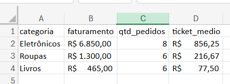
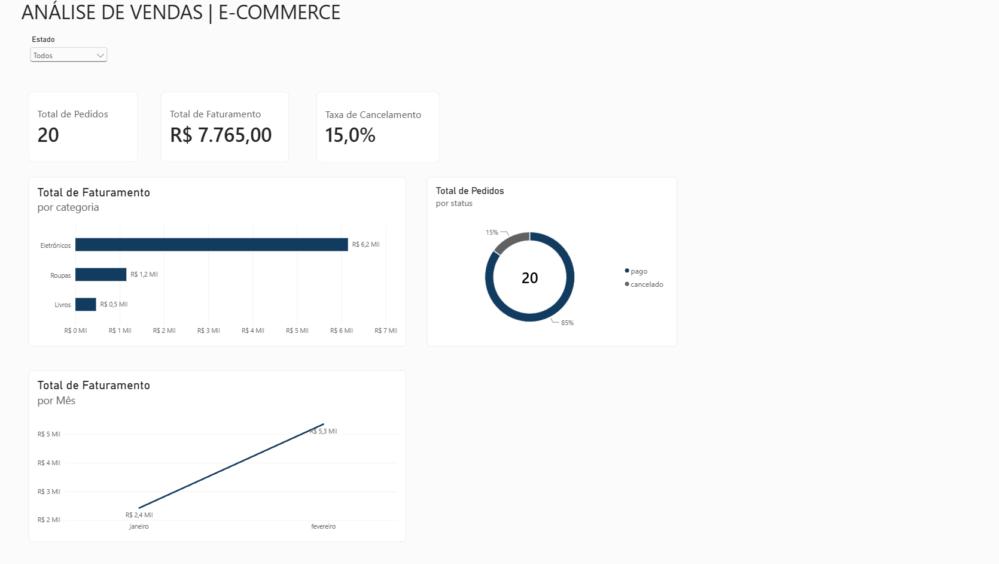

# 📊 Análise de Vendas de E-commerce e SQL Analítico Avançado (PostgreSQL)

Projeto prático de análise de dados e engenharia de consultas SQL, focado em modelagem relacional, integridade referencial, segmentações condicionais, CTEs e Window Functions para inteligência de negócios.

---

## 🎯 Objetivo de Negócio
Simular um ambiente real de e-commerce estruturado sob arquitetura relacional para extrair métricas estratégicas de performance comercial e integridade de base:
- Faturamento consolidado, volume transacional e ticket médio por cliente e estado.
- Performance de receita e volume por categoria de produto.
- Monitoramento e impacto financeiro de pedidos cancelados.
- Auditoria cadastral: identificação de clientes inativos (anti-join), taxa de ativação regional e tratamento rigoroso de valores nulos com `COALESCE`.
- Inteligência avançada: segmentação de clientes por faixas de receita (`CASE WHEN`), cálculos percentuais com CTEs em cadeia e rankings analíticos (`ROW_NUMBER`, `DENSE_RANK`).

---

## 🛠️ Tecnologias e Conceitos Aplicados
- **Linguagens & Ecossistema:** Python, SQL (PostgreSQL).
- **Bibliotecas Python:** `pandas` (manipulação e agregações), `psycopg` (conexão segura), `python-dotenv` (gestão de variáveis de ambiente), `openpyxl` (motor para Excel).
- **SGBD & Ferramentas:** PostgreSQL, VS Code, Git e GitHub.
- **DDL & DML:** Modelagem de tabelas, tipos de dados (`DECIMAL`, `DATE`, `VARCHAR`), constraints (`PRIMARY KEY`, `FOREIGN KEY`, `NOT NULL`).
- **DQL & Análise Relacional:**
  - Junções: `INNER JOIN`, `LEFT JOIN`, `CROSS JOIN`, Anti-Joins (`IS NULL`), predicados na cláusula `ON`.
  - Agregações & Filtros: `GROUP BY`, `HAVING`, `COUNT(DISTINCT)`, `SUM`, `AVG`, `ROUND`.
  - Tratamento de Dados: `COALESCE` para consistência em valores `NULL`.
- **SQL Avançado & Negócios:**
  - Regras Condicionais: `CASE WHEN` para segmentação de clientes e contagem condicional (pivotagem) dentro de agregações.
  - CTEs (Common Table Expressions): Cláusula `WITH` simples e encadeada para modularização e subqueries escalares.
  - Window Functions: Funções analíticas de janela (`ROW_NUMBER`, `DENSE_RANK`) com `OVER (PARTITION BY ... ORDER BY ...)` para rankings sem colapso de granularidade.

---

## ⚙️ Instalação e execução

### Pré-requisitos

- PostgreSQL
- Python 3
- Git
- Visual Studio Code

### 1. Clonar o repositório

```bash
git clone https://github.com/Italolima209/ecommerce-sales-sql-analysis.git
cd ecommerce-sales-sql-analysis
```

### 2. Configurar o ambiente Python

Crie e ative um ambiente virtual:

```powershell
python -m venv .venv
.\.venv\Scripts\Activate.ps1
```

Instale as dependências:

```bash
python -m pip install -r requirements.txt
```

### 3. Configurar as credenciais do banco de dados

Crie um arquivo `.env` na raiz do projeto com as configurações da sua conexão PostgreSQL:

```dotenv
DB_HOST=localhost
DB_PORT=5432
DB_NAME=nome_do_banco
DB_USER=seu_usuario
DB_PASSWORD=sua_senha
```

Substitua os valores de exemplo pelas configurações do banco local. O arquivo `.env` não deve ser enviado ao repositório.

### 4. Preparar o banco de dados

Com o PostgreSQL em execução e uma conexão configurada no VS Code, execute os scripts SQL na ordem numérica:

1. `sql/01_schema_e_dados.sql`
2. `sql/02_consultas_analiticas.sql`
3. `sql/03_analises_relacionais_join.sql`
4. `sql/04_auditoria_joins_avancados.sql`
5. `sql/05_analises_avancadas_negocio.sql`

O primeiro script cria a estrutura e insere os dados de teste. Os demais realizam as consultas e análises de negócio.

### 5. Testar a conexão com o banco

Com o ambiente virtual ativado, execute:

```bash
python src/conexao_banco.py
```

### 6. Executar as análises em Python

```bash
python src/analise_vendas.py
```

### 7. Exportar os resultados para Excel

```bash
python src/exportar_excel.py
```

O arquivo Excel é gerado conforme o caminho definido no script de exportação.

---

## 🗄️ Modelagem Relacional (Schema)

```text
+-------------------+              +----------------------+
|     CLIENTES      |              |        PEDIDOS       |
+-------------------+              +----------------------+
| id_cliente (PK)   | 1 ------ < N | id_pedido (PK)       |
| nome              |              | id_cliente (FK)      |
| cidade            |              | categoria            |
| estado            |              | valor                |
|                   |              | status               |
|                   |              | data_pedido          |
+-------------------+              +----------------------+
```
---

## 📈 Relatório Automatizado (Python + Excel)

O sistema conta com um script automatizado (`src/exportar_excel.py`) que conecta ao PostgreSQL de forma segura (utilizando variáveis de ambiente e gestão de contexto `with`), processa os dados com agregações profissionais do Pandas (`groupby` e `.agg`) e exporta o resumo comercial diretamente para uma folha de cálculo formatada.




## Dashboard Interativo (Power BI)

Foi desenvolvido um dashboard interativo no Power BI Desktop conectado ao banco de dados PostgreSQL para visualização dos principais indicadores de negócio:

- **Métricas e KPIs:** Total de Pedidos, Total de Faturamento e Taxa de Cancelamento.
- **Análises:** Distribuição de faturamento por categoria, status dos pedidos e evolução temporal mensal das vendas.
- **Filtros:** Segmentação interativa por estado do cliente.

